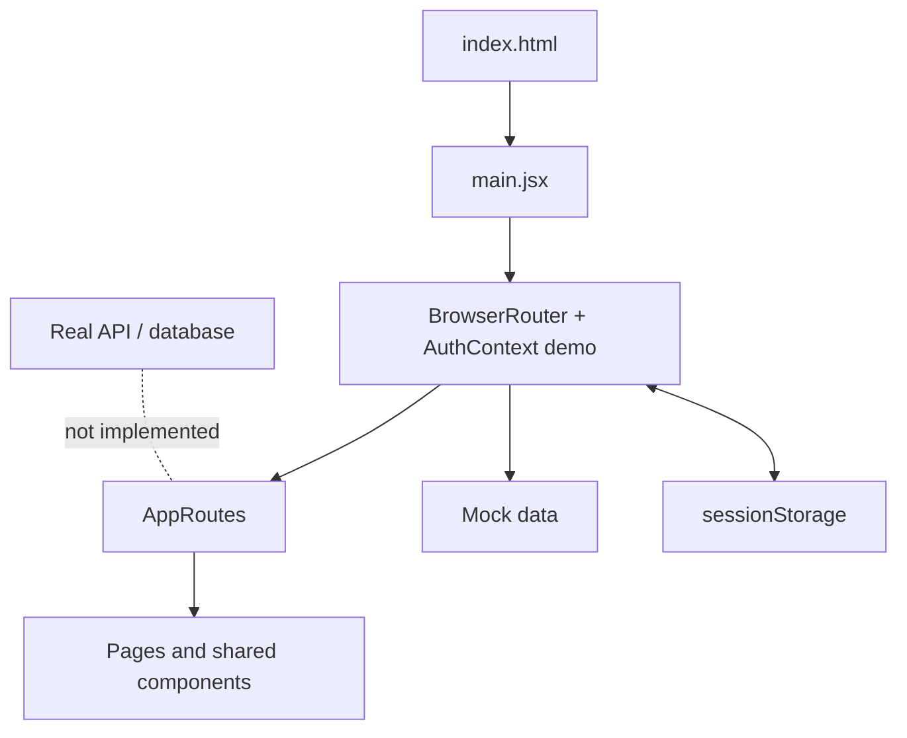

# NSA 2.0 — Protótipo de portal acadêmico

Front-end demonstrativo de um portal acadêmico, desenvolvido com React e Vite. O objetivo é experimentar navegação e interfaces para perfis de aluno e professor; não é uma integração oficial com o NSA nem um sistema pronto para uso escolar real.

## Estado real

- **Implementado:** telas de demonstração, navegação SPA, layout compartilhado e alternância de perfis simulados.
- **Dados:** objetos locais em `src/services/mock/mockData.js`.
- **Sessão:** estado local com `sessionStorage`; não comprova a identidade de ninguém.
- **Não implementado:** autenticação real, backend acadêmico, banco de dados, integração oficial, persistência de notas/frequência, autorização de servidor ou gestão real de usuários.
- **Qualidade:** há scripts de desenvolvimento, build e preview; não há scripts npm de testes ou lint configurados no `package.json`.

## Arquitetura

## Arquitetura



```text
index.html
  └─ src/main.jsx
      ├─ BrowserRouter
      ├─ AuthProvider (estado demonstrativo)
      └─ src/App.jsx
          └─ src/routes/AppRoutes.jsx
              ├─ /login → Login
              └─ rotas protegidas → páginas
                  ├─ Dashboard
                  ├─ Grades / Attendance
                  ├─ Schedule / Subjects
                  ├─ Documents / Requests
                  ├─ Notifications / Profile
                  └─ AppLayout e componentes comuns
```

### Camadas e responsabilidades

- `src/main.jsx`: ponto de entrada React, roteador, contexto de sessão e estilos globais.
- `src/App.jsx`: composição da aplicação.
- `src/routes/AppRoutes.jsx`: definição das rotas e guarda visual `RequireAuth`.
- `src/context/AuthContext.jsx`: escolhe perfil de aluno ou professor a partir de dados locais e registra a escolha no `sessionStorage`.
- `src/pages/`: telas por área funcional.
- `src/components/`: layout e componentes visuais reutilizáveis.
- `src/services/mock/mockData.js`: dados de demonstração.
- `src/services/api/`: módulos preparados para chamadas de API; sua presença não significa que exista backend conectado.
- `src/styles/`: estilos globais e responsivos.

A proteção de rotas é somente lógica de interface. Qualquer usuário pode escolher um perfil demonstrativo; não use dados reais ou credenciais reais.

## Rotas documentadas

| Caminho | Tela |
|---|---|
| `/login` | seleção de perfil demonstrativo |
| `/` | painel |
| `/notas` | notas demonstrativas |
| `/frequencia` | frequência demonstrativa |
| `/horario` | horário |
| `/disciplinas` | disciplinas |
| `/notificacoes` | aviso/estado da funcionalidade |
| `/documentos` | documentos demonstrativos |
| `/solicitacoes` | solicitações demonstrativas |
| `/perfil` | perfil e saída da sessão |

Confira `src/routes/AppRoutes.jsx` antes de adicionar ou renomear rotas. O guia [README-NAVEGACAO.md](./README-NAVEGACAO.md) explica os caminhos de arquivo com mais detalhe.

## Requisitos e comandos

- Node.js e npm.

```bash
npm install
npm run dev
npm run build
npm run preview
```

O build usa o caminho-base `/NSA-2.0/`; `vite.config.js` e o roteamento precisam permanecer alinhados caso o local de publicação mude.

## Verificação automatizada

O workflow `.github/workflows/ci.yml` executa `npm ci` e `npm run build` em pushes e pull requests. Isso verifica a compilação, não substitui testes funcionais, acessibilidade ou revisão de segurança. O resultado remoto ainda precisa ser confirmado após a execução do workflow.

## Segurança, implantação e limitações

- Não inserir dados pessoais ou escolares reais: o projeto não tem controles de acesso reais.
- Não armazenar segredos no front-end.
- Build concluído é apenas uma verificação de compilação, não valida segurança ou correção funcional.
- Não há pipeline de testes automatizados/lint definido nos scripts atuais.
- A publicação de arquivos estáticos não transforma o protótipo em sistema conectado; links e rotas precisam ser servidos com fallback de SPA.
- A documentação de build e auditoria de dependências descreve verificações pontuais e não garante ausência de vulnerabilidades futuras.

**Autor:** Luca Toniolo — [@Lvc4br](https://github.com/Lvc4br)
